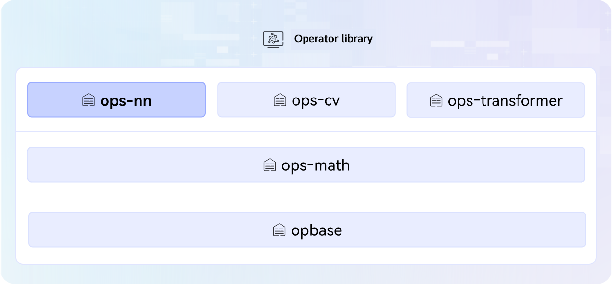

<div align="center">

# ops-transformer

English | [简体中文](./README.md)

[](https://www.hiascend.com/document/redirect/CannCommunityOplist)
[](docs)
[](LICENSE)
[](CONTRIBUTING_en.md)
[](https://atomgit.com/cann/community/blob/master/CANN/sigs/ops-transformer/README.md)
[![Zread](https://img.shields.io/badge/Zread-Ask_AI-_.svg?style=flat&color=0052D9&labelColor=000000&logo=data%3Aimage%2Fsvg%2Bxml%3Bbase64%2CPHN2ZyB3aWR0aD0iMTYiIGhlaWdodD0iMTYiIHZpZXdCb3g9IjAgMCAxNiAxNiIgZmlsbD0ibm9uZSIgeG1sbnM9Imh0dHA6Ly93d3cudzMub3JnLzIwMDAvc3ZnIj4KPHBhdGggZD0iTTQuOTYxNTYgMS42MDAxSDIuMjQxNTZDMS44ODgxIDEuNjAwMSAxLjYwMTU2IDEuODg2NjQgMS42MDE1NiAyLjI0MDFWNC45NjAxQzEuNjAxNTYgNS4zMTM1NiAxLjg4ODEgNS42MDAxIDIuMjQxNTYgNS42MDAxSDQuOTYxNTZDNS4zMTUwMiA1LjYwMDEgNS42MDE1NiA1LjMxMzU2IDUuNjAxNTYgNC45NjAxVjIuMjQwMUM1LjYwMTU2IDEuODg2NjQgNS4zMTUwMiAxLjYwMDEgNC45NjE1NiAxLjYwMDFaIiBmaWxsPSIjZmZmIi8%2BCjxwYXRoIGQ9Ik00Ljk2MTU2IDEwLjM5OTlIMi4yNDE1NkMxLjg4ODEgMTAuMzk5OSAxLjYwMTU2IDEwLjY4NjQgMS42MDE1NiAxMS4wMzk5VjEzLjc1OTlDMS42MDE1NiAxNC4xMTM0IDEuODg4MSAxNC4zOTk5IDIuMjQxNTYgMTQuMzk5OUg0Ljk2MTU2QzUuMzE1MDIgMTQuMzk5OSA1LjYwMTU2IDE0LjExMzQgNS42MDE1NiAxMy43NTk5VjExLjAzOTlDNS42MDE1NiAxMC42ODY0IDUuMzE1MDIgMTAuMzk5OSA0Ljk2MTU2IDEwLjM5OTlaIiBmaWxsPSIjZmZmIi8%2BCjxwYXRoIGQ9Ik0xMy43NTg0IDEuNjAwMUgxMS4wMzg0QzEwLjY4NSAxLjYwMDEgMTAuMzk4NCAxLjg4NjY0IDEwLjM5ODQgMi4yNDAxVjQuOTYwMUMxMC4zOTg0IDUuMzEzNTYgMTAuNjg1IDUuNjAwMSAxMS4wMzg0IDUuNjAwMUgxMy43NTg0QzE0LjExMTkgNS42MDAxIDE0LjM5ODQgNS4zMTM1NiAxNC4zOTg0IDQuOTYwMVYyLjI0MDFDMTQuMzk4NCAxLjg4NjY0IDE0LjExMTkgMS42MDAxIDEzLjc1ODQgMS42MDAxWiIgZmlsbD0iI2ZmZiIvPgo8cGF0aCBkPSJNNCAxMkwxMiA0TDQgMTJaIiBmaWxsPSIjZmZmIi8%2BCjxwYXRoIGQ9Ik00IDEyTDEyIDQiIHN0cm9rZT0iI2ZmZiIgc3Ryb2tlLXdpZHRoPSIxLjUiIHN0cm9rZS1saW5lY2FwPSJyb3VuZCIvPgo8L3N2Zz4K&logoColor=ffffff)](https://zread.ai/hicann/ops-transformer)
[](https://atomgit.com/cann/cann-samples)

</div>

---

## 🔥Latest News

- [2026/08] The repository integrates the [pre-commit code check framework](docs/zh/develop/pre-commit_guide.md). After configuration, `git commit` automatically checks and fixes format issues, intercepting specification issues at the commit stage and improving code merge efficiency. For details, see the [pre-commit configuration guide](docs/zh/develop/pre-commit_guide.md).
- [2026/07] The [quant_flash_attn](attention/quant_flash_attn) operator is newly supported on A5, dedicated to the fully quantized Dense Attention scenario. The experimental directory adds an [operator with the same name](experimental/attention/quant_flash_attn) that supports MxFP4 full quantization on A5. The [chunk_gated_delta_rule](attention/chunk_gated_delta_rule) operator supports A5. A5 adds the DSV4 dense training-stage TopK filtering backward operators [dense_lightning_indexer_grad_kl_loss](attention/dense_lightning_indexer_grad_kl_loss) and [dense_lightning_indexer_softmax_lse](attention/dense_lightning_indexer_softmax_lse). mc2 newly supports the [engram_fetch_grad](mc2/engram_fetch_grad) operator.
- [2026/06] [sparse_flash_mla](attention/sparse_flash_mla), [mixed_quant_sparse_flash_mla](attention/mixed_quant_sparse_flash_mla), and the corresponding metadata operators are newly supported on A5 for sparse Attention computation in the DSV4 scenario. [lightning_indexer_v2](attention/lightning_indexer_v2), [quant_lightning_indexer_v2](attention/quant_lightning_indexer_v2), and the corresponding metadata operators are added for TopK filtering in the DSV4 scenario. A5 adds the DSV4 sparse training-stage Attention backward operators [sparse_flash_mla_grad](attention/sparse_flash_mla_grad) and [sparse_lightning_indexer_kl_loss_grad](attention/sparse_lightning_indexer_kl_loss_grad). mc2 newly supports the [engram_fetch](mc2/engram_fetch) and [engram_fetch_wait](mc2/engram_fetch_wait) operators.
- [2026/05] The [fused_infer_attention_score](attention/fused_infer_attention_score) operator supports MxFP8 full quantization on A5. The [flash_attn](attention/flash_attn) operator is newly supported on A5, dedicated to the non-quantized Dense Attention scenario.
- [2026/04] mc2 newly supports the [mega_moe](mc2/mega_moe) operator.
- [2026/03] The [recurrent_gated_delta_rule](attention/recurrent_gated_delta_rule) operator supports A5.
- [2026/02] Newly supported operators: [mhc_post](experimental/mhc/mhc_post), [mhc_pre](experimental/mhc/mhc_pre), and [mhc_res](experimental/mhc/mhc_res).
- [2026/01] Added the [grouped_matmul<<<>>> invocation example](examples/fast_kernel_launch_example/csrc/grouped_matmul) for convenient customized use.
- [2026/01] Newly supported operators: [fused_floyd_attention](attention/fused_floyd_attention), [fused_floyd_attention_grad](attention/fused_floyd_attention_grad), and [matmul_allto_all](mc2/matmul_allto_all).
- [2025/12] Added [QuickStart](docs/QUICKSTART.md), which guides beginners with zero experience through operator project deployment (Docker environment supported), operator development, and the contribution process.
- [2025/12] Optimized the guide documents, focusing on the [Operator Development Guide](docs/zh/develop/aicore_develop_guide.md), clarifying the minimal deliverables and key sample code, and providing guidance on migrating operators from the [Ascend/samples](https://gitee.com/ascend/samples/tree/master) repository to this project.
- [2025/12] Supports transformer-type ONNX operator plugins, including [NPUMultiHeadAttention](common/src/framework), [NPUMoeComputeExpertTokens](moe/moe_compute_expert_tokens/framework), and so on.
- [2025/12] Newly supported operators: [kv_rms_norm_rope_cache](posembedding/kv_rms_norm_rope_cache), [attention_update](attention/attention_update), [attention_worker_scheduler](attention/attention_worker_scheduler), [gather_pa_kv_cache](attention/gather_pa_kv_cache), [kv_quant_sparse_flash_attention](attention/kv_quant_sparse_flash_attention), [lightning_indexer_grad](attention/lightning_indexer_grad), [mla_preprocess](attention/mla_preprocess), [mla_preprocess_v2](attention/mla_preprocess_v2), [grouped_matmul_swiglu_quant_v2](gmm/grouped_matmul_swiglu_quant_v2), [attention_to_ffn](mc2/attention_to_ffn), and [ffn_to_attention](mc2/ffn_to_attention).
- [2025/12] Open-source operators support development and debugging with the [NPU Simulator](docs/zh/debug/npu_sim.md) simulation tool.
- [2025/12] Open-source operators support the [Ascend 950PR&950DT products](docs/zh/ascend950_op_list.md)/KirinX90 products.
- [2025/11] Newly supported operators: [kv_quant_sparse_flash_attention](attention/kv_quant_sparse_flash_attention), [lightning_indexer](attention/lightning_indexer), [quant_lightning_indexer](attention/quant_lightning_indexer), and [sparse_flash_attention](attention/sparse_flash_attention).
- [2025/11] Added the sample operators [rope_matrix](experimental/posembedding/rope_matrix) and [all_gather_add](examples/mc2/all_gather_add).
- [2025/11] Added the operator development project template [NpuOpsTransformerExt](experimental/npu_ops_transformer_ext), which seamlessly integrates PyTorch tensor operations and supports automatic differentiation and a unified GPU/NPU interface.
- [2025/10] Added the [experimental](experimental) directory and improved the [Contribution Guide](CONTRIBUTING_en.md), allowing developers to debug and contribute custom operators.
- [2025/09] The ops-transformer project goes online for the first time, with open-source operators supporting Atlas A2/A3 products.

## 🚀Overview

ops-transformer is an advanced operator library in the [CANN](https://hiascend.com/software/cann) (Compute Architecture for Neural Networks) operator library that provides computation for transformer-type large models. It includes the attention, moe, and mc2 operator categories, covering various scenarios such as attention computation, MoE computation, and communication-computation fusion. The position of the operator library in the architecture diagram is as follows.



## 📌Version Compatibility

The source code of this project is released along with CANN software versions. For the mapping between CANN software versions and tags of this project, refer to the corresponding version descriptions in the [release repository](https://atomgit.com/cann/release-management).
Note that to ensure smooth customized development of your source code, select a compatible CANN version and the source code of the corresponding Gitcode tag. Using the master branch may cause version mismatch risks.

## 🛠️Environment Preparation

[Environment deployment](docs/zh/install/quick_install.md) is the prerequisite for experiencing the capabilities of this project. Complete the NPU driver and CANN package installation first to ensure that the environment works properly.

## ⬇️Source Code Download

After the environment is ready, download the branch source code that matches the CANN version. The general command is as follows, where \$\{tag\_version\} is replaced with the branch tag name. The following uses downloading the 9.0.0 branch source code as an example:

```bash
# General command: git clone -b ${tag_version} https://atomgit.com/cann/ops-transformer.git
git clone -b 9.0.0 https://atomgit.com/cann/ops-transformer.git
```

> Description: If the compatible branch source code already exists in the environment, **you can skip this step**. For example, CANNLab provides the source code corresponding to the latest CANN version by default.

## 📖Learning Tutorials

- [Quick Start](docs/QUICKSTART.md): Quickly experience the core basic capabilities of the project from scratch, covering source code compilation, operator invocation, development, debugging, and other operations.
- [Advanced Tutorials](docs/README.md): If you need to learn more about project compilation and deployment, operator invocation, development, debugging and tuning, and other capabilities, see the documentation center for detailed guidance.

## 📘Sample Practice

To learn high-performance practical cases in the operator domain, see the [cann-samples Performance directory](https://atomgit.com/cann/cann-samples/blob/master/Samples/2_Performance/README.md).

| Operator category | Sample | Description |
| --- | --- | --- |
| attention | [full_quant_fused_infer_attention_score_story](https://atomgit.com/cann/cann-samples/blob/master/Samples/2_Performance/full_quant_fused_infer_attention_score_story/README.md) | Provides a per-block full-quantization example for the FIA (Fused Infer Attention Score) operator, including input data generation, operator execution, and result verification. |
| mc2 | [moe_dispatch_and_combine_story](https://atomgit.com/cann/cann-samples/blob/master/Samples/2_Performance/moe_dispatch_and_combine_story/README.md) | Performance optimization practice for the moe dispatch/combine communication operators, including build and run commands, test data generation, and precision verification. |
| moe | [moe_init_routing_story](https://atomgit.com/cann/cann-samples/blob/master/Samples/2_Performance/moe_init_routing_story/README.md) | End-to-end tuning guide for the MoeInitRoutingV3 operator, covering multi-core parallelism, memory bandwidth optimization, in-core pipeline scheduling, SIMT programming, and hardware feature adaptation. |

## 💬Related Information

- [Directory Structure](docs/zh/install/dir_structure.md)
- [Operator Index](docs/zh/op_list.md)
- [aclnn API Index](docs/en/op_api_list.md)
- [torch API Index](docs/en/torch_api_list.md)
- [Contribution Guide](CONTRIBUTING_en.md)
- [Security Statement](SECURITY_en.md)
- [License](LICENSE)
- [SIG](https://atomgit.com/cann/community/tree/master/CANN/sigs/ops-transformer)
- [Contact Us] WeChat: Clark_Dan

-----
PS: The features and documentation of this project are continuously being updated and improved. Stay tuned for the latest version.

- **Issue feedback**: Submit issues through GitCode [Issues](https://atomgit.com/cann/ops-transformer/issues).
- **Community interaction**: Join discussions through GitCode [Discussions](https://atomgit.com/cann/ops-transformer/discussions).
- **Technical column**: Get technical articles (such as serialized tutorials and best practices) through GitCode [Wiki](https://atomgit.com/cann/ops-transformer/wiki).


​
