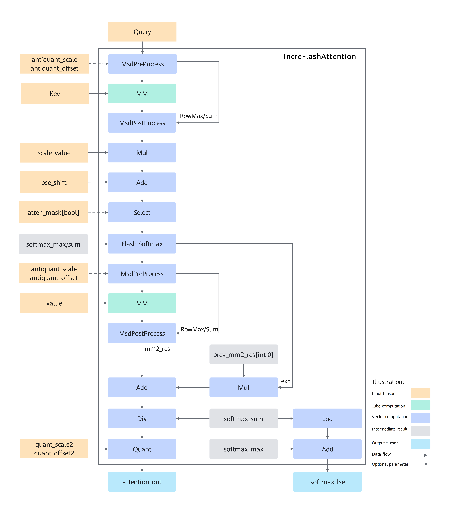

Declaration: This document uses the [Creative Commons License version 4.0](https://creativecommons.org/licenses/by/4.0/legalcode). Reproduction, citation, or modification must follow this license agreement.

# IFA Operator Design Introduction

To continuously optimize and improve incremental inference performance, the requirement for the IncreFlashAttention fused operator that supports incremental inference was proposed.

Compared with full inference, incremental inference has the following main differences:

1. The S dimension of query in the input data is fixed to 1;
2. Key and Value are kv cache results that stack the state information computed in previous inference steps. The actual S dimension length may differ for each batch, and the input data is fixed-length data after padding.

## Implementation Principle

Figure 1 shows the computation flow:



The implementation follows the FlashAttention forward computation process. The overall computation flow is as follows:

1. After the matmul computation of query and the transposed key, the initial attention_score is obtained. Then the position encoding pse is added, and the result is multiplied by the scaling coefficient scale_value. The result is then processed through the select operation with atten_mask, masking the positions that are true in atten_mask, producing masked_attention_score. That is, positions that are true in atten_mask become a negative minimum value after the select operation, and become 0 after the softmax computation, achieving the masking effect.

2. To implement the FlashAttention acceleration algorithm, the FlashSoftmax operation is used to process masked_attention_score, replacing the softmax operation in the original formula, and then the result is multiplied with value through matmul. Since the FlashSoftmax operation splits masked_attention_score along the Skv direction (the sequence length of input key and value), a refresh process exists in the implementation, as described below:

   1. Each FlashSoftmax computation operates on only one SkvSplit after splitting (SkvSplit is short for the sequence length after splitting the Skv dimension), and records exp starting from the second loop iteration, where i is the loop variable after Skv splitting. For exp, i starts from 1. The formula for exp is as follows:
      $$
      exp[i] = e^{max_{i - 1} - max_{i}}
      $$

   2. Starting from i = 1, Mul and Add operations are added: the result of the previous MM[PV] is multiplied by the current exp, and the product is added to the result of the current MM[PV]. The sum is saved to GM. This process is repeated until the traversal of Skv is complete.

   3. Since the division by sum in the FlashSoftmax computation is moved to just before the output of attention_out, the attention_out in ub needs to be divided by softmax_sum row by row at the end, and the final complete result is saved to the output memory attention_out(Final).

## Template Design

To allow different inputs to reuse the same tiling and pipeline, the fused operator is implemented using templates. However, when all different inputs use the same set of templates, optimal performance and functional generalization cannot be achieved. Therefore, different templates need to be implemented based on the characteristics of the input shape.

### Template Types

1. C+V template: corresponds to the file name incre_flash_attention_split_Bbn2s2_Us2.h. It is the basic IFA template and supports most input scenarios. During computation, both VectorCore and CubeCore are enabled, and matmul computation is executed on CubeCore. The matmul computation calls the high-level APIs provided by AscendC;
2. All-Vector template: corresponds to the file name incre_flash_attention_allvec_new.h. It supplements the C+V template, and its main flow is basically the same as that of the C+V template. The matmul computation is implemented by vector, reducing the Cube startup and CV communication overhead. It delivers better performance for some input types. Supported scenarios:

- <term>Atlas inference products</term>: This template is used for all scenarios.

- <term>Atlas A2 products</term>: non-PA, non-GQA, and all Q, KV, and Output types are FP16.

3. matmul basic API template: corresponds to the file name incre_flash_attention_preload.h. To optimize performance, the matmul part is rewritten using the matmul basic APIs provided by AscendC based on the C+V template. The following changes are mainly made based on the C+V template:

- Switches the programming perspective. The C+V template uses the VEC-based programming perspective, where one VEC needs to process all computation results of one matmul. This template uses the CUBE-based programming perspective, where the computation result of one matmul is split into two parts, and two VECs process one part each.

- Optimizes the inter-core pipeline between CUBE and VEC. The C+V template uses sequential pipelining, while this template uses N-Buffer pipelining. N-Buffer pipelining means that a computation stage is executed N consecutive times before the next computation stage is executed N consecutive times.

- Optimizes the pipeline within the CUBE core. The Buffer resources within the CUBE core are uniformly scheduled between the two matmul computations of FA, making the data transfer and computation pipeline within the CUBE core more compact, thereby improving performance.
For the support scope of this template, see the EnableCubeViewMM function in Tiling.

4. Pseudo-quantization MSD DD template: corresponds to the file incre_flash_attention_preload_dd.h. It is developed based on incre_flash_attention_preload.h, used for the pseudo-quantization MTP scenario, and optimizes the MSD algorithm. This template is developed based on incre_flash_attention_preload.h. Currently only the FIA operator can call this template; the IFA operator does not call it.

5. MLA full-quantization template: corresponds to the file incre_flash_attention_preload_mla.h. It applies to the attention computation in the MLA scenario where query, key, and value are INT8 and query_rope and key_rope are BF16. This template is developed based on incre_flash_attention_preload.h, and the matmul-related computation is extracted into the file ifa_service_matmul_full_quant.h. Currently only the FIA operator can call this template; the IFA operator does not call it.
The following section mainly introduces the C+V template. Other templates will be gradually merged into the FIA operator and are not described here for now.

### Computation Process

#### Data Splitting

Since the hardware buffer size is limited while the amount of data to compute is huge and cannot be computed at once, tiling splitting is required. Different shapes lead to different splitting dimensions of the operator, and the splitting dimensions affect the function and performance of the template. Simple element-wise operators often fuse all dimensions into one dimension for splitting, which is simple in logic, so their templates are relatively simple. Fused operators integrate multiple scenario types such as element-wise, broadcast, reduce, and matmul, with complex functions. To meet high performance requirements, templates often need to be split based on the splitting dimensions. To achieve optimal performance during template splitting, the following points need to be considered:

a. Use all cores to prevent some cores from being idle;

b. The computation assigned to each core is relatively even, avoiding the situation where some cores compute too much data while other cores are idle;

c. The amount of data processed by AIC and AIV must match their computing power, preventing AIC or AIV from being idle for a long time.

The IFA operator contains five dimensions: B, N2 (N of key and value), G (query_N/kv_N), S1 (S of query), and S2 (S of key and value). The S1 dimension is fixed to 1 and does not participate in splitting. The G dimension is split into blocks only during Vector computation. The BN2S2 splitting logic is as follows:

- Inter-core: External data splitting maximizes the use of multiple cores working in parallel. Usually, cores are first allocated by BN2, that is, BN2 SD blocks are distributed to multiple cores, and each core computes a certain number of SD blocks. When BN2 is less than the threshold (0.4 * the total number of cores), the S2 dimension also needs to be externally split (into SplitKV parts). The total number of blocks is BN2* SplitKv, and each core is assigned a certain number of sub-blocks. After all sub-blocks are computed, reduction is performed, which is the FlashDecode process.

- Intra-core: Since the cache of a single core is limited, the S2 dimension or the S2 dimension of the KV sub-block needs to be split according to the configured cache size. This is the FlashAttention process.

#### Main Flow

```c
// Pseudocode for single-core computation
void compute() {
  loops = blocks_to_compute_of_this_core(); // Number of data blocks that the current core needs to compute

  for (i = 0; i < loops; i++) {
    block = get_curr_block(i);
    bidx, nidx, sidx = dims_of_this_block(block);

    innerloops = get_inner_loops_of_this_block_by_actual_seq_len(bidx, nidx, sidx); // Actual number of internal splits of the data block
    q_offset = get_offset_of_query(bidx, nidx);

    softmax_sum = {0};
    softmax_exp = {0};
    softmax_max = {min_float};

    for (j = 0; j < innerloops; j++) { // flash attention loop
      kv_offset = get_offset_of_kv_block(j);

      qk_res = matmul(q + q_offset, k + kv_offset);

      qk_res = elementwise(qk_res); // pse, atten-mask

      qk_res, softmax_max, softmax_sum, softmax_exp = softmaxflash(qk_res, softmax_max, softmax_sum);

      res = matmul(qk_res, v + kv_offset);

      prev_res = load_prev_res();
      res += prev_res * softmax_exp;  // flash attention update
      store(res);

      if (j == innerloops - 1) {
        res = div(res, softmax_sum);
        output(res);
      }
    }
  }
}
```

#### FlashDecode

After the S2 dimension is externally split and assigned to different cores to complete the Attention computation, the Reduce operation is performed on the results. There are BN2 SD blocks in total, and each core merges all sub-blocks in one block.

```c
// FlashDecode reduction, single-core flow
void combine() {
  SyncAll(); // Inter-core synchronization to ensure all sub-blocks are computed
  splits = get_real_splits_of_this_block_by_actual_seq_len();
  lse = load_lse_of_this_block();
  scale[0:splits] = exp(lse[i]) / Sum(exp(lse[i]));  // i [0, splits)

  res = {0};
  split_res = load_split_res();
  for (j = 0; j < splits; j++) {
    res += split_res[j] * scale[j];
  }
  output(res);
}
```

#### AntiQuant MSD Algorithm

The matrix computation formula for the IFA AntiQuant scenario is:
$$
C = A * (B + offset)\times scale
$$
Matrix A is of type FP16/BF16, and matrix B is of type int8.

In the classic dequantization scheme, the dequantization operation on the entire matrix B requires moving matrix B into Vector for processing. The data volume of matrix B is large, which severely affects the computation performance.

In the IFA scenario, matrix A is small, so matrix A can be transformed to adapt to matrix B. The basic process is as follows:

1. Matrix A enters Vector and is expanded into multiple rows, and each row An is stored in int8 format;
2. These An values are packed into a new matrix AA to compute CC = AA *B (computed as int8* int8 = int32);
3. The Reduce operation is performed on the MatMul result CC to obtain C.

#### PageAttention

The KV block memory is not contiguous. MatMul provides a callback function for this scenario to copy matrix B (GM->L1). IFA implements the corresponding copy function. The callback function is executed in Cube, and parameters are passed through GM. After Vector sets the corresponding parameters to GM (ensuring DCCI), it notifies MatMul to work.

#### GQA

G = queryheadNum / KvHeadNum. The splitting of the G dimension on Vector is determined by the UB size of the inputs and outputs involved in the current operation. When G is too large, the UB cache is insufficient to load all data at once for computation, so the G dimension needs to be split:

```c
// GQA vector G-splitting pseudocode
void process() {
  g = target_ub_size() / column_size;
  if (g > G) {
    g = G;
  }
  process_sub_block(g, column); // sub_block: g * column
}
```

## Tiling Design

### Core Splitting Design

        Tiling operations aim to find a more efficient NPU execution method. The original data volume is usually very large and cannot be computed by a single instruction call. Therefore, the data volume needs to be distributed to multiple cores for parallel computation, and each core also needs to consider how to achieve the optimal loop computation performance. Different inputs may have different optimal execution methods. Therefore, the Tiling strategy needs to decide how to allocate data to each core for computation.

As described above, the total number of blocks is BN2 or BN2*SplitKv

- Input: number of cores + number of blocks + block load (usually the actual S dimension length of each block);

- Processing: consecutive blocks are combined and rearranged based on the load values to minimize the inter-core load difference;

- Output: a blockid array, where each element corresponds to the starting blockid of a core, and the last additional element equals the total number of blocks. The difference between consecutive elements is the number of blocks processed by that core.

### TilingKey Planning

TilingKey is of the uint64 type. Usually each template parameter corresponds to one decimal digit in TilingKey, and some BOOL template parameters are combined and represented in one decimal digit. For the implementation details, see the GenTilingKey function in Tiling.

```c++
constexpr uint64_t RecursiveSum() {
  return 0;
}

template <typename T, typename... Args>
constexpr uint64_t RecursiveSum(T templateId, Args... templateIds) {
  return static_cast<uint64_t>(templateId) + 10U * RecursiveSum(templateIds...);
}
constexpr uint64_t IFA_TILINGKEYOFFSET = uint64_t(10000000000000000UL);           // 10^16
constexpr uint64_t IFA_PERF_MODE_TILINGKEYOFFSET = uint64_t(1000000000000000UL);  // 10^15
template <typename... Args>
constexpr uint64_t IFA_GET_TILINGKEY(Args... templateIds) {
  return RecursiveSum(templateIds...);
}

GenTilingKey()
{
  ...
  uint64_t baseOffset =
      modeVal * IFA_TILINGKEYOFFSET + (static_cast<uint64_t>(perfMode_)) * IFA_PERF_MODE_TILINGKEYOFFSET;
  if (antiquantMode_ == PER_TOKEN_MODE || antiquantMode_ == PER_CHANNEL_MODE){
      context_->tilingKey = baseOffset + IFA_GET_TILINGKEY(layoutVal, inputQVal, inputKvVal, outputVal, originVal,
          (paVal + splitKvVal + antiquantModeVal), 0, kvLayoutInfo.kvLayoutVal, kvLayoutInfo.amlaMode, balanceMode);
  } else {
      context_->tilingKey = baseOffset + IFA_GET_TILINGKEY(layoutVal, inputQVal, inputKvVal, outputVal, originVal,
          (paVal + splitKvVal), antiquantMode_, kvLayoutInfo.kvLayoutVal, kvLayoutInfo.amlaMode, balanceMode);
  }
  ...
}

```

Field descriptions:

| Decimal Digit | Variable                  | Description                                                                                                             |
| -------- | -------------------------| ------------------------------------------------------------ |
| 0        | layoutVal                | Shape format of Q, 0: BNSD; 1: BSH/BSND; 2: TND                    |
| 1        | inputQVal                | Data type of query, 0: FP16; 2: BF16; 3: INT8                    |
| 2        | inputKvVal               | Data type of KV, 0: FP16; 2: BF16; 3: INT8; 4: INT4                  |
| 3        | outputVal                | Data type of output, 0: FP16; 2: BF16; 3: INT8                    |
| 4        | originVal                | Same as inputQval                                                  |
| 5 [bit0] | splitKvVal               | Flag for enabling FlashDecode, 1: enable; 0: disable                   |
| 5 [bit1] | paVal                    | Flag for enabling PageAttention, 1: enable; 0: disable                 |
| 5 [bit2] | antiquantModeVal         | Flag for enabling PerToken pseudo-quantization, 1: enable; 0: disable                 |
| 6        | antiquantMode_           | Quantization mode, 0: invalid value; 2: K-perChannel-V-perToken                   |
| 7        | kvLayoutInfo.kvLayoutVal | Shape format of KV. This field is valid only for the pseudo-quantization MSD DD template and the MLA full-quantization template, and its value is 0 for other templates. 0: BNSD; 1: BSH/BSND; 2: NZ |
| 8        | kvLayoutInfo.amlaMode    | This field is deprecated and can only be 0 |
| 9        | balanceMode              | Flag for enabling the new load balancing algorithm, 1: enable; 0: disable; can be enabled only by the MLA full-quantization template |
| 10...14   |                         | Reserved fields with the value 0              |
| 15       | perfMode_                | Template ID, 0: C1_V2 (CV ratio 1:2); 1: all-V; 2: C1_V1 (CV ratio 1:1); 3: matmul basic API template; 5: MLA full-quantization template; 6: pseudo-quantization MSD DD template |
| 16       | modeVal                  | 1: IFA TilingKey Base; 2: IFA enables the SysPrefix function              |
