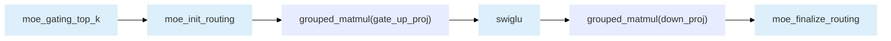

# GroupedMatmul

English | [简体中文](./README.md)

## Introduction

GroupedMatmul is an important operator in MoE networks. Its core function is to pack tokens that are already grouped by expert and complete the matrix multiplication of all groups at one time. It supports grouping along the M axis or K axis and covers three computation scenarios: non-quantization, pseudo-quantization, and full quantization. In MoE inference, GroupedMatmul is usually invoked twice: the first invocation performs grouped matrix multiplication between the input tokens and the up-projection weights of each expert to obtain the intermediate results of each expert; the second invocation performs grouped matrix multiplication between the intermediate results and the down-projection weights of each expert to obtain the output of each expert.

---

## Product Support

|Product      | Supported |
|:----------------------------|:-----------:|
|<term>Ascend 950PR&950DT products</term>|      √     |
|<term>Atlas A3 products</term>|      √     |
|<term>Atlas A2 products</term>|      √     |
|<term>Atlas 200I/500 A2 inference products</term>|      ×     |
|<term>Atlas inference products</term>|      √     |
|<term>Atlas training products</term>|      ×     |
|<term>Kirin X90 processor series products</term> | √ |
|<term>Kirin 9030 processor series products</term> | √ |

---

## Terms

| Term | Description |
|------|----------|
| Non-quantization | Both the left and right matrices are of floating-point types and are directly computed |
| Full quantization | Both the left and right matrices are computed in low precision and restored through scale. For details, see [Quantization Introduction](../../docs/zh/context/quant_mode_introduction_en.md) |
| Pseudo-quantization | The weights of the right matrix are quantized, including the perchannel quantization mode |
| pertensor | Also known as T quantization. All tensors share the same quantization parameter |
| perchannel | Also known as C quantization. The quantization object is the right matrix, and each channel uses an independent quantization parameter |
| pertoken | Also known as K quantization. The quantization object is the left matrix, and each token uses an independent quantization parameter |
| pergroup | Also known as G quantization. Data is grouped along the reduce axis, and each group uses an independent quantization parameter |
| perblock | Also known as B quantization. Data is blocked along all axes, and each block uses an independent quantization parameter |
| T-C | The left matrix is pertensor and the right matrix is perchannel |
| T-T | The left matrix is pertensor and the right matrix is pertensor |
| K-C | The left matrix is pertoken and the right matrix is perchannel |
| K-T | The left matrix is pertoken and the right matrix is pertensor |
| G-B | The left matrix is pergroup and the right matrix is perblock |
| MX | A special case of the pergroup-pergroup (G-G) quantization mode, where the quantization parameter type is FLOAT8_E8M0 and the group size is 32 |
| ND | Conventional contiguous arrangement |
| NZ | [FRACTAL_NZ](../../docs/zh/context/data_format_en.md) format (hardware-affine arrangement) |

## Function Description

Interface function: Implements grouped matrix multiplication. The formula is $y_i[m_i,n_i]=x_i[m_i,k_i] \times weight_i[k_i,n_i], i=1...g$, where $g$ is the number of groups.

- **Grouping along the M axis (groupType=0)**: $k_i$ and $n_i$ are the same for all groups, and $m_i$ can differ.
- **Grouping along the K axis (groupType=2)**: $m_i$ and $n_i$ are the same for all groups, and $k_i$ can differ.

Basic computation formula:

$$
y_i=x_i\times weight_i + bias_i
$$

For the detailed computation formulas (classified by scenario: non-quantization, pseudo-quantization, and full quantization) and version evolution, see [aclnnGroupedMatmulV5 Function Description](docs/aclnnGroupedMatmulV5_en.md#description).

---

## Parameter Description

| Parameter name | Input/Output/Attribute | Description | Data type | Data format |
|--------|:---:|------|----------|:-----------:|
| x | Input | Input $x$ in the formula | FLOAT, FLOAT16, INT321, INT8, INT4, BFLOAT16, FLOAT8_E5M22, FLOAT8_E4M3FN2, HIFLOAT82, FLOAT4_E2M12, FLOAT4_E1M22 | ND |
| weight | Input | $weight$ in the formula | FLOAT, FLOAT16, INT32, INT8, INT4, BFLOAT16, FLOAT8_E5M22, FLOAT8_E4M3FN2, HIFLOAT82, FLOAT4_E2M12, FLOAT4_E1M22 | ND/NZ |
| biasOptional | Optional input | $bias$ in the formula | FLOAT, FLOAT16, INT32, BFLOAT162 | ND |
| scaleOptional | Optional input | $scale$ in the formula, indicating the scaling factor in the quantization parameters | FLOAT, UINT64, BFLOAT16, FLOAT8_E8M02, INT642 | ND/NZ |
| offsetOptional | Optional input | $offset$ in the formula, indicating the offset in the quantization parameters | FLOAT | ND |
| antiquantScaleOptional | Optional input | $antiquant\_scale$ in the formula, indicating the scaling factor in the pseudo-quantization parameters | FLOAT16, BFLOAT16, FLOAT8_E8M02 | ND |
| antiquantOffsetOptional | Optional input | $antiquant\_offset$ in the formula, indicating the offset in the pseudo-quantization parameters | FLOAT16, BFLOAT16 | ND |
| perTokenScaleOptional | Optional input | $per\_token\_scale$ in the formula, indicating the scaling factor introduced by x quantization in the quantization parameters | FLOAT, FLOAT8_E8M02 | ND |
| groupListOptional | Optional input | Indicates the matmul size distribution along the grouping axis of inputs and outputs | INT64 | ND |
| activationInputOptional | Optional input | Indicates the backward input of the activation function. Currently, only nullptr can be passed in | - | - |
| activationQuantScaleOptional | Optional input | Quantization scaling factor of the activation function (reserved parameter). Currently, only nullptr can be passed in | - | - |
| activationQuantOffsetOptional | Optional input | Quantization offset of the activation function (reserved parameter). Currently, only nullptr can be passed in | - | - |
| <abbr title="Indicates whether the output needs to be split into tensors: 0/1 = multi-tensor output; 2/3 = single-tensor output">splitItem</abbr> | Optional attribute | Indicates whether the output needs to be split into tensors. The default value is 0 | INT64 | - |
| <abbr title="Specifies the grouping axis: -1 = no grouping, 0 = M axis, 2 = K axis">groupType</abbr> | Optional attribute | Indicates the axis to be grouped. The default value is -1 (no grouping) | INT64 | - |
| <abbr title="Indicates the grouping mode of the groupList input: 0 = cumulative sum; 1 = size of each group; 2 = [group index, group size] pairs">groupListType</abbr> | Optional attribute | Indicates the grouping mode of the groupList input. The default value is 0 (cumulative sum) | INT64 | - |
| <abbr title="Indicates the activation function type: 0 = NONE/1 = ReLU/2 = GELU_TANH/4 = FAST_GELU/5 = SILU">actType</abbr> | Optional attribute | Indicates the activation function type. The default value is 0 (the activation function is not enabled) | INT64 | - |
| tuningConfigOptional | Optional attribute | The default value is `[0]`. When the aclnn API is not used, nullptr can be passed in. The first number indicates the expected number of tokens processed by each expert; when the second number is set to 1, A8W4 can optionally enable the offline special weight format arranged as `[E,N,K]` and converted to NZ (this does not mean `transposeWeight=true`); the third number indicates the extra memory space allowed | INT64 | - |
| out | Output | Output $y$ in the formula | FLOAT, FLOAT16, INT32, INT8, BFLOAT16 | ND |
| activationFeatureOutOptional | Output | Input data of the activation function. Currently, only nullptr can be passed in | - | - |
| dynQuantScaleOutOptional | Output | Dynamic quantization scaling factor. Currently, only nullptr can be passed in | - | - |

- <term>Ascend 950PR&950DT products</term>:
  - The superscript 1 in the Data type column of the preceding table indicates data types not supported by this series.
  - The input parameter x does not support the INT32 type.
  - In the non-quantization scenario, the input parameters x and weight and the output parameter out support up to 1024 tensors; in the pseudo-quantization scenario, they support up to 128 tensors; the full quantization scenario supports multiple tensors.
- <term>Atlas A2 products</term> and <term>Atlas A3 products</term>:
  - The superscript 2 in the Data type column of the preceding table indicates data types not supported by this series.
  - The input parameters x and weight do not support the FLOAT8_E5M2, FLOAT8_E4M3FN, HIFLOAT8, FLOAT4_E2M1, or FLOAT4_E1M2 types.
  - The input parameter biasOptional does not support BFLOAT16.
  - The input parameter scaleOptional does not support the FLOAT8_E8M0 or INT64 types.
  - The input parameters antiquantScaleOptional and perTokenScaleOptional do not support the FLOAT8_E8M0 type.
  - The input parameters x and weight and the output parameter out support up to 128 tensors.
- <term>Kirin X90 processor series products</term> and <term>Kirin 9030 processor series products</term>:
  - The BFLOAT16, FLOAT8_E5M2, FLOAT8_E4M3FN, FLOAT8_E8M0, and HIFLOAT8 types are not supported.

---

## Constraint Description

### Common Constraints

- When x/weight is transposed, the corresponding tensor must be [non-contiguous](../../docs/zh/context/non_contiguous_tensor_en.md).
- When weight is in the [FRACTAL_NZ](../../docs/zh/context/data_format_en.md) format, the shape must meet the NZ format requirements.
- perTokenScaleOptional: 1D in the per-token scenario, with the shape (M,); 3D in the MX quantization scenario, with the shape (M, ceil(K / 64), 2). In the MX quantization scenario of WeightNZ, x and out are supported as a single tensor and weight is supported as multiple tensors; for the specific supported combinations, see the corresponding API document.
- groupListOptional: when the TensorList length in out is 1, groupList constrains the valid range of output data, and the unspecified parts do not participate in the update.
- groupListType:
  - groupListType=0: must be a non-negative, monotonically non-decreasing sequence (cumulative sum).
  - groupListType=1: must be a non-negative sequence (size of each group).
  - groupListType=2: must be a non-negative sequence with the shape `[E, 2]` ([group index, group size]), with non-zero groups placed first.

> For the detailed constraints of each scenario, see [aclnnGroupedMatmulV5 Constraint Description](docs/aclnnGroupedMatmulV5_en.md#constraints).  
> For the detailed constraints of the weight NZ scenario, see [aclnnGroupedMatmulWeightNz Constraint Description](docs/aclnnGroupedMatmulWeightNz_en.md#constraints).

---

## Invocation Description

| Invocation Method | Invocation Sample | Description |
|----------|----------|------|
| aclnn API | [test_aclnn_grouped_matmul_v5_noquant](examples/arch35/test_aclnn_grouped_matmul_v5_noquant.cpp) | Calls the GroupedMatmul operator through the two-phase [aclnnGroupedMatmulV5](docs/aclnnGroupedMatmulV5_en.md) API. |
| aclnn API | [test_aclnn_grouped_matmul_weight_nz](examples/arch35/test_aclnn_grouped_matmul_weight_nz.cpp) | Calls the operator through the two-phase [aclnnGroupedMatmulWeightNz](docs/aclnnGroupedMatmulWeightNz_en.md) API, where weight is parsed in the FRACTAL_NZ format. |
