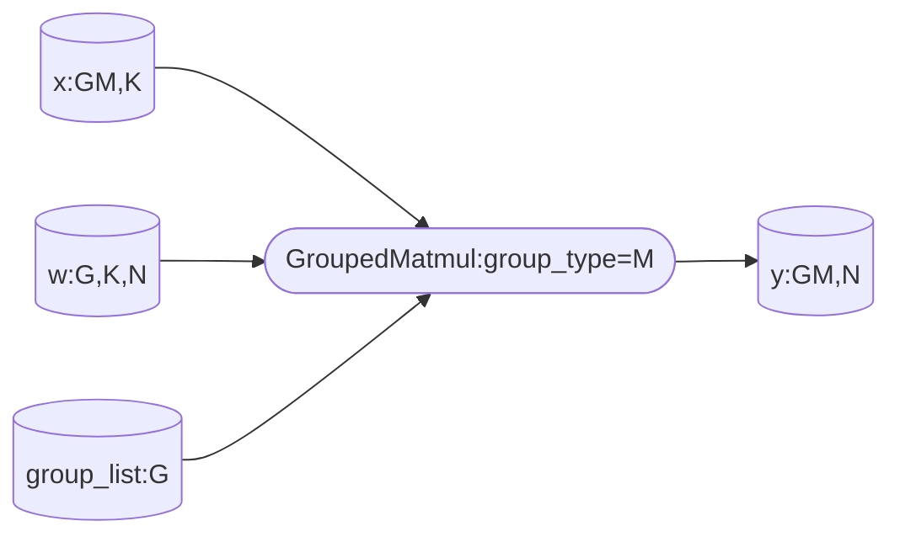
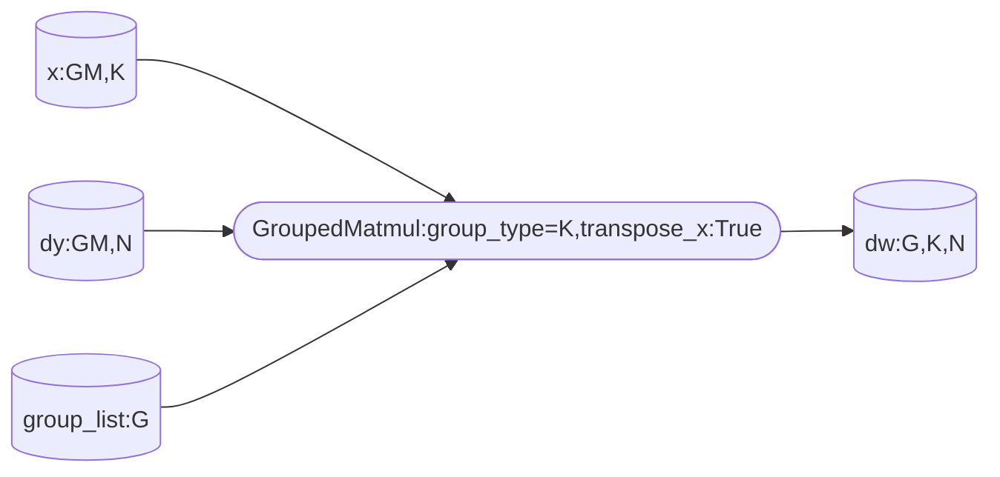

Declaration: This document uses the [Creative Commons License version 4.0](https://creativecommons.org/licenses/by/4.0/legalcode). Reproduction, citation, modification, and other operations must comply with this license.

# 1 GroupedMatmul Fused Operator Design Introduction

The GroupedMatmul operator performs grouped matrix multiplication, and the dimension sizes of each group of matrix multiplication can be different. The matrix multiplication formula is as follows:
$$
y_i[m_i,n_i]=x_i[m_i,k_i] \times weight_i[k_i,n_i], i=1...g
$$
where g is the number of groups, and $m_i$, $k_i$, and $n_i$ are the corresponding shapes.
When implementing the GroupedMatmul operator, the following two aspects also need to be considered:

1. Different parameters and data types are supported, such as with or without bias, different activation function types, and different scenarios such as non-quantization, quantization, and pseudo-quantization. Different scenarios correspond to different computation processes and different performance optimization methods. Therefore, the implementation is divided into different templates, each with its own template parameters.
2. The AiCore memory size on hardware is limited. Generally, completing the computation of an operator requires splitting the data and pipelining and parallelizing the data movement and computation processes. This process has a great impact on the operator and is the main adjustment object in the performance optimization stage. The tiling function on the host computes the parameters for this splitting and pipelining.

# 2 Scenario Division

From the functional perspective, the scenarios can be divided into the non-quantization scenario, quantization scenario, and pseudo-quantization scenario. At the code level, the specific template is selected in three ways:

1. Compilation macros: the macros ORIG_DTYPE_X and ORIG_DTYPE_WEIGHT compiled based on the data types of x and weight.
2. Tilingkey: for example, whether x/weight is transposed.
3. TilingData: for example, isPerTokenQuant in tiling indicates whether it is per-token quantization.
Description:

- Non-quantization means that x, weight, and y are all floating-point types, such as float16/bfloat16/float32. Non-quantization is a pure cube scenario, and its computation process is implemented by the matmul high-level API.
- Quantization means that x and weight are low-precision integer types. GroupedMatmul supports the A8W8 scenario, including per-tensor + per-channel quantization and per-token + per-channel quantization (referred to as per-token quantization).
- Pseudo-quantization means that x is a floating-point type and weight is a low-precision integer type. GroupedMatmul supports the A16W8 and A16W4 scenarios.

## 2.1 Per-Token Quantization

This chapter uses the per-token quantization scenario as an example to describe the algorithm flow of GroupedMatmul. The computation process is as follows:
matmul(int32) -> dequantization (fp32) -> mul(fp32) -> activation function (fp32) (optional) -> cast(fp16/bf16). The perTokenScale input of mul(fp32) also needs to be broadcast from shape (m) to (m, n).


## 2.2 Grouping Methods

For different scenarios, GroupedMatmul can be grouped by the m axis or the k axis, also known as M-splitting and K-splitting. In the forward training process, grouping is performed on the m axis; when computing gradients in the backward pass, grouping needs to be performed on the k axis.

- m-axis grouping: $k_i$ is the same for all groups, and $weight_i/y_i$ can be concatenated along $n_i$. In this case, group type = 0.
  m-axis grouping can be used in the non-quantization forward training scenario, the quantization scenario, and the pseudo-quantization scenario.



- k-axis grouping: $k_i$ differs from group to group, but $m_i/n_i$ is the same for each group. In this case, $x_i/weight_i$ can be concatenated along $k_i$. k-axis grouping is used only in the non-quantization training scenario to compute the gradient of the loss with respect to the weight. Since computing the weight gradient requires transposing x, x changes from m-axis grouping to k-axis grouping after transposition.



## 2.3 Multi-Tensor/Single-Tensor Support

The GroupedMatmul operator supports multiple tensors or a single tensor as inputs and outputs.
A single tensor means that the tensors of all groups in a tensor list are merged into 1 along the grouping axis specified by groupType; otherwise, there are multiple tensors.
The following table describes the tensor shapes supported by different schemes, where "single" means a single tensor and "multiple" means multiple tensors, listed in the order of x, weight, y. For example, "single-multiple-single" indicates the scenario where x is a single tensor, weight is multiple tensors, and y is a single tensor.

| group_type | supported scenario | x shape | weight shape | y shape | optional-dynamic inputs shape if needed | group_list shape if passed | per_token_scale shape if passed |
| :--------: | :----------------: | :-----: | :----------: | :-----: | :-------------------------------------: | :------------------------: | :-----------------------------: |
| -1         |        multiple-multiple-multiple         | [(M1,K1),(M2,K2),...] | [(K1,N1),(K2,N2),...] | [(M1,N1),(M2,N2),...] | [(N1),(N2),...] | not support | not support |
| 0          |        single-single-single         | [(M,K)] | [(G,K,N)] | [(M,N)] | [(G,N)] | (G) | (M) |
| 0          |        single-multiple-single         | [(M,K)] | [(K,N),(K,N),...] | [(M,N)] | [(N),(N),...] | (G) | not support |
| 0          |        multiple-multiple-single         | [(M1,K1),(M2,K2),...] | [(K1,N),(K2,N),...] | [(M,N)] | [(N),(N),...] | (G) | not support |

For example, in the multiple-multiple-multiple scenario, the x shape is {{4, 16}, {12, 16}, {16, 16}}, the weight shape is {{16, 8}, {16, 8}, {16, 8}}, and the y shape is {{4, 8}, {12, 8}, {16, 8}}. To perform the same computation in the single-single-single scenario, the x shape is {32, 16}, the weight shape is {3, 16, 8}, the y shape is {32, 8}, and groupList={4, 12, 16}.

# 3 Tiling Design

## 3.1 TilingData Design

```c++
BEGIN_TILING_DATA_DEF(GMMTilingData)
  TILING_DATA_FIELD_DEF_STRUCT(GMMBaseParams, gmmBaseParams);
  TILING_DATA_FIELD_DEF_STRUCT(GMMArray, gmmArray);
  TILING_DATA_FIELD_DEF_STRUCT(TCubeTiling, mmTilingData);
END_TILING_DATA_DEF;
```

The tilingData mainly contains the three parts in the preceding structures:

1. GMMBaseParams: basic tiling parameters of GroupedMatmul, such as the number of groups, the number of Aicore cores, UB tiling parameters, and matmul core-splitting tiling parameters, as well as functional parameters such as whether there is an activation function, the quantization type (per token or per tensor), and the activation function type.
2. GMMArray: when the input consists of multiple tensors, the shape of the matmul of each group is recorded through three arrays, and the kernel obtains them through GlobalTensor::GetValue(). When the inputs are all single tensors, one of the m/k/n values is in group_list, and the other two values are the same in all groups. In this case, the kernel only needs to access the first value in the array.
3. TCubeTiling: the tilingData corresponding to the matmul high-level API.

To avoid allocating the three arrays in GMMArray in the stack space and copying these arrays in the kernel, the GET_TILING_DATA_MEMBER API is used to copy the structures other than GMMArray.

## 3.2. UB Buffer Allocation

In the initialization stage, GroupedMatmul needs to determine the allocation and reuse of UB buffers. The computation processes of non-quantization and pseudo-quantization are simple and do not reuse UB buffers, while the quantization scenario is complex, so UB buffers need to be reused to increase the amount of data processed in a single computation.
Define the byte size allocated for each buffer divided by the number of data elements processed (baseM\*baseN, denoted as ubCalcSize, where baseM/baseN are parameters of the vector computation) as the number of copies of that buffer. Taking per-token quantization as an example, assuming baseM = 24 and baseN = 256, then ubCalcSize = baseM * baseN = 6 KB.

The UB buffer allocation is as follows:


1. The input of the vector computation, that is, the output of matmul, is of the int32 type. After doubleBuffer is enabled, the input requires sizeof(int32) * 2, that is, 8 buffers.
2. The output of the vector computation is fp16/bf16, which requires sizeof(fp16/bf16) * 2, that is, 4 buffers.
3. The intermediate computation process of the vector computation requires applying for tmpBuffer. The output of broadcast requires sizeof(fp32) blocks of buffer, the output of dequantization requires sizeof(fp32) blocks of buffer, and sharedBuffer needs to be applied for buffer reuse, including the broadcast temporary space, the dequantization temporary space, and the Mul output, with a size of 8 buffers. In total, the size of tmpBuffer to be applied for is 16 buffers.

The total UB buffer to be allocated is 28 * 6 KB = 168 KB.

## 3.3 Basic Block Core Partitioning Scheme

When implementing GroupedMatmul, the case where the input consists of multiple tensors needs to be considered, that is, the shape of the matmul of each group may differ. The kernel side cannot configure a separate matmul high-level API instance for the matmul of each group (neither the tiling structure nor the core stack space size allows it). To adapt to matmul computation with different shapes, GroupedMatmul adopts the basic block approach (horizontal core partitioning), performing core partitioning computation with baseM and baseN as basic blocks. Here, baseM/baseN are matmul parameters.


## 3.4 Diagonal Core Partitioning Scheme

When cores are partitioned according to the basic block scheme, the same-address access problem easily occurs. For example, when nDim=coreNum in the basic block scheme, all cores access the same address of the left matrix at the same time, which greatly affects performance. Therefore, when the number of basic blocks exceeds coreNum (when it does not exceed coreNum, the diagonal scheme cannot solve the same-address access problem), the following diagonal scheme can be adopted, so that different cores stagger their data accesses as much as possible at the same time. Each square represents a basic output block, and the number represents the traversal order of basic blocks (horizontal core partitioning is the original basic block core partitioning scheme).


For scenarios suitable for diagonal optimization, the input data is accessed multiple times in the basic block scheme. When nDim/mDim is very large, the "diagonal" cannot be extended downward arbitrarily; otherwise, in scenarios where the k value is relatively large, the input data corresponding to the diagonal are all different data, and the data that has been loaded once is evicted from the L2 cache by new data. When it needs to be loaded later, it still has to be loaded from DDR memory, causing performance degradation. Therefore, the diagonal range needs to be limited to make full use of the data cached in the L2 cache.


Group the diagonal traversal by thresholds. To avoid same-address access as much as possible, the thresholds in both directions should preferably not be less than the actual number of physical cores. Therefore:

$$
\min(T_m, T_n) \geq numCore
$$

To make full use of the cache, the total data volume of $X$, $Weight$, and $Y$ corresponding to a grouping block should preferably not exceed the L2 cache size of the device. Therefore:

$$
sizeof(dtype) \cdot (T_m \cdot singleM \cdot K + K \cdot T_n \cdot singleN + T_m \cdot singleM \cdot T_n \cdot singleN) \leq L2_{size}
$$

If the two conditions cannot be satisfied at the same time, a trade-off must be made based on the actual situation.
